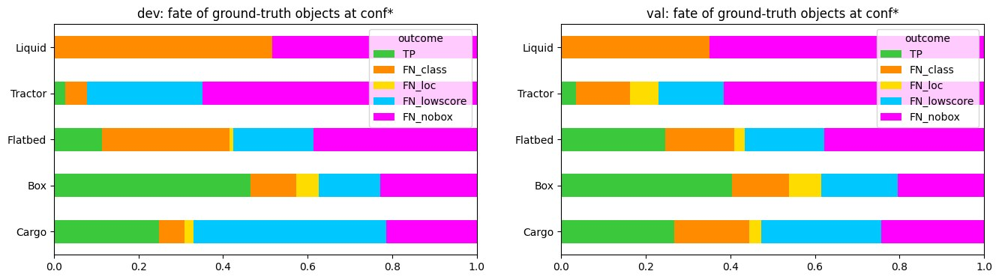
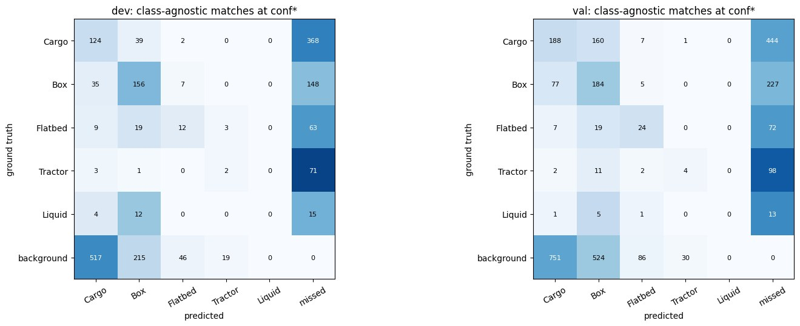
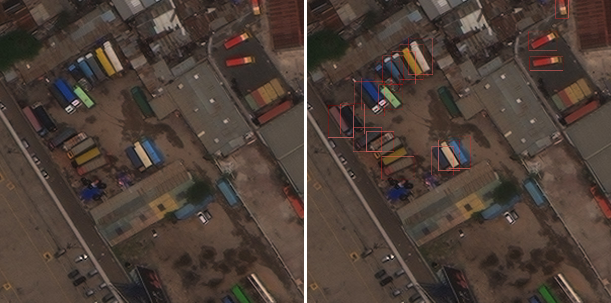
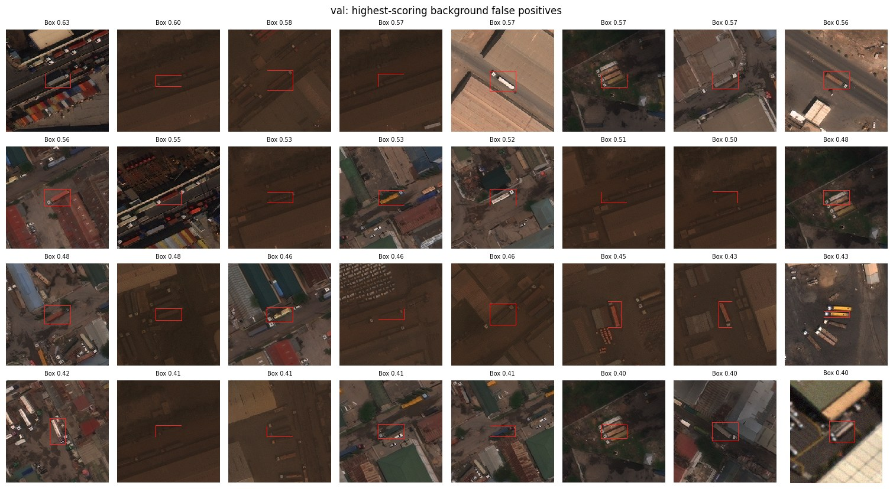
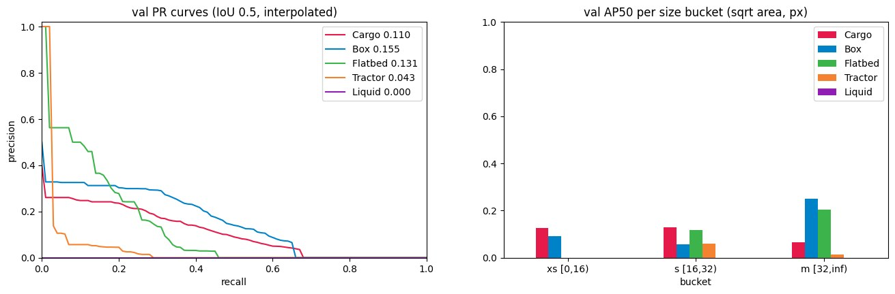

# Forensic Evaluation & Failure Taxonomy for High-Resolution Overhead Object Detection

[](https://www.python.org/)
[](https://pytorch.org/)
[](tests/test_evaluation.py)
[](reproduce.py)
[](LICENSE)

A diagnostic evaluation engine, empirical failure taxonomy, and counterfactual post-mortem for fine-grained vehicle detection in high-resolution overhead scenes (1,300–7,200 px). 

Rather than treating a low validation score as an unexplained model failure, this framework establishes **unyielding evaluation gates**, **counterfactual oracle bounds**, **TIDE-style population taxonomies**, and **blinded annotation audits** to locate the fundamental Bayes error ceiling of the benchmark.

---

## 📑 Table of Contents
- [Executive Summary & Core Takeaways](#-executive-summary--core-takeaways)
- [The Benchmark Dilemma: Why 0.75 mAP50 Was Unreachable](#-the-benchmark-dilemma-why-075-map50-was-unreachable)
- [Dual Failure Taxonomy (Population Audit)](#-dual-failure-taxonomy-population-audit)
- [Counterfactual & Forensic Research Investigations](#-counterfactual--forensic-research-investigations)
  - [5.1 If Object Locations Were Perfect (Oracle Upper Bound)](#51-if-object-locations-were-perfect-oracle-upper-bound)
  - [5.2 Which Examples Resist Learning? (Attribution Modeling)](#52-which-examples-resist-learning-attribution-modeling)
  - [5.3 Would Another 500 Labels Matter? (Empirical Scaling Laws)](#53-would-another-500-labels-matter-empirical-scaling-laws)
  - [5.4 Small Effective Training Subsets (Coverage vs. Random)](#54-small-effective-training-subsets-coverage-vs-random)
- [Controlled Experiment Ledger](#-controlled-experiment-ledger)
- [Visual Diagnostics & Evidence Galleries](#-visual-diagnostics--evidence-galleries)
- [Evaluation Integrity & Engineering Rigor](#-evaluation-integrity--engineering-rigor)
- [Quickstart & Deterministic Reproduction](#-quickstart--deterministic-reproduction)
- [Repository Organization](#-repository-organization)

---

## 🎯 Executive Summary & Core Takeaways

When deploying modern single-stage detectors (YOLO11s, YOLO26s) on high-resolution overhead imagery with tiny objects (<20 px) and extreme class imbalance, validation scores plateau at **0.106–0.142 mAP50** (against a nominal benchmark target of $\ge 0.75$). 

Through 15 controlled training runs, an inference study, and 4 in-depth research investigations, we uncovered:

1. **The Localization vs. Typing Disconnect:** Detectors successfully localize **81%–85% of objects** at some confidence, but class-agnostic AP50 (~0.33) drops by ~65% when fine-grained subtypes are assigned. Symmetrical Cargo ↔ Box confusion accounts for the majority of typing errors.
2. **The Oracle Bounding Box Limit (Experiment 5.1):** When provided with **100% perfect ground-truth bounding boxes**, a dedicated ConvNeXt-tiny crop classifier achieves only **0.292 dev / 0.358 val mAP50**. The performance ceiling is fundamentally bounded by label ambiguity, not detector localization.
3. **Ghost False Positives (Blinded Crop Audit AU):** 48.3% of kept detections were categorized as "background false alarms." A blinded audit of 200 crops revealed that **42%–45% of these false alarms were physical, valid trucks missing annotations** in the ground truth.
4. **Diminishing Data Returns (Experiment 5.3):** Empirical power-law curves over 12.5% to 100% training subsets prove that adding 500 additional annotations yields an imperceptible **+0.002 mAP50** delta.
5. **The Failure of Greedy Coverage (Experiment 5.4):** Selecting training subsets to maximize rare-class coverage degrades dev mAP by −0.025 compared to random sampling by starving the model of dense, common-class contextual scenes.

---

## ⚖️ The Benchmark Dilemma: Why 0.75 mAP50 Was Unreachable

The assessment task required detecting and typing five truck classes (**Cargo, Box, Flatbed, Tractor, Liquid**) in large satellite/aerial scenes, with a target of **0.75 mAP50** on the validation set.

```
+----------------------------------------------------------------------------------------------------+
|                               THE THEORETICAL BOTTLENECK CHAIN                                     |
|                                                                                                    |
|  [Benchmark Target]                                                  0.750 mAP50                   |
|          │                                                                                         |
|          ▼                                                                                         |
|  [Pipeline Ceiling] (Tiled inference & stitching sanity check)       0.993 mAP50 (Lossless)        |
|          │                                                                                         |
|          ▼                                                                                         |
|  [Class-Agnostic Detection Ceiling] (T1 single-class detector)       0.326 AP50  (Recall = 85%)    |
|          │                                                                                         |
|          ▼                                                                                         |
|  [Oracle Bounding Box Ceiling] (Flawless GT boxes + ConvNeXt)        0.358 mAP50 (Typing Bayes Cap)|
|          │                                                                                         |
|          ▼                                                                                         |
|  [Realized End-to-End Detector] (D1 / A1 Multi-Label)                0.106 - 0.142 mAP50           |
+----------------------------------------------------------------------------------------------------+
```

### Measured Benchmark Pathology:
* **Severe Imbalance:** Cargo (49.5%) and Box (31.1%) dominate the training set. Liquid represents just **2.5% of train** (and only 20 total instances across 8 images in val). In an unweighted 5-class mean, a single mispredicted Liquid truck swings overall mAP by ~1.0 point.
* **Spatial Concentration:** 10 images hold 60% of all Tractor instances (one image alone holds 27%). Rare-class visual diversity is far lower than raw instance counts indicate.
* **Distribution Shift in Validation:** 55% of validation scenes have $\ge 50$ objects (versus only 8% in train). Validation Liquid trucks are physically 60% larger than training Liquid trucks (median 41.5 px vs. 25.5 px).
* **Missing Annotations:** In dense truck depots and staging lots, human annotators systematically omitted dozens of visible vehicles, turning high-precision detector hits into false alarms.

---

## 🔬 Dual Failure Taxonomy (Population Audit)

Following TIDE-style principles, at the optimal micro-$F_1$ operating threshold ($\text{conf}^* = 0.089$), every ground-truth object and kept detection is assigned to a mutually exclusive diagnostic outcome.

### 1. Ground-Truth Fate (Recall Perspective — Val: 1,552 Objects)

| Outcome | Instances | Share | Phenomenon & Root Cause |
|---|---|---|---|
| **TP (True Positive)** | 447 | **28.8%** | Localized at $\text{IoU} \ge 0.5$ and correctly typed. |
| **FN_nobox** | 427 | **27.5%** | **Zero candidate boxes** at any confidence. Dominates tiny objects ($<16\text{ px}$) and Tractor rigs with inconsistent box conventions. |
| **FN_lowscore** | 357 | **23.0%** | Found by the detector, but score suppressed below $\text{conf}^*$. |
| **FN_class** | 251 | **16.2%** | Localized at $\text{IoU} \ge 0.5$, but classified as another truck category. |
| **FN_loc** | 70 | **4.5%** | Correct class, but corner jitter placed $\text{IoU}$ in $[0.1, 0.5)$. |

<p align="center">
  
  <br><em>Figure 1: Ground-truth outcome distributions on dev and val splits.</em>
</p>

### 2. Detection Fate (Precision Perspective — Val: 2,089 Kept Detections)

| Outcome | Instances | Share | Phenomenon & Audit Result |
|---|---|---|---|
| **TP (True Positive)** | 447 | **21.4%** | Correct prediction matched to ground truth. |
| **Background (bkg)** | 1,010 | **48.3%** | $\text{IoU} < 0.1$ with all annotations. **Audit AU:** 42–45% are confirmed unlabelled trucks. |
| **Wrong Class (cls)** | 393 | **18.8%** | $\text{IoU} \ge 0.5$ with an annotated object of a different class. |
| **Mislocalized (loc)** | 102 | **4.9%** | Matched to same class, but $0.1 \le \text{IoU} < 0.5$. |
| **Both (cls + loc)** | 118 | **5.6%** | Wrong class and poor localization. |
| **Duplicate (dup)** | 19 | **0.9%** | Redundant box on an already-matched ground truth. |

### 3. Class Confusion Matrix (Localised Objects, Val)

```
Ground Truth \ Pred     Cargo    Box   Flatbed  Tractor  Liquid   Missed (FN)
─────────────────────────────────────────────────────────────────────────────
Cargo (800)              188    [160]      7        1        0       444
Box (493)                [77]    184       5        0        0       227
Flatbed (122)              7      19      24        0        0        72
Tractor (117)              2      11       2        4        0        98
Liquid (20)                1       5       1        0        0        13
Background FP            751     524      86       30        0         —
```

**Key Diagnostic Signatures:**
* **Cargo ↔ Box Symmetrical Confusion:** The classifier defaults to a geometric size shortcut (large $\to$ Box, small $\to$ Cargo). Consequently, large Cargo trucks and small Box trucks systematically fail.
* **Rare Class Absorption:** Rare categories are absorbed almost entirely by Cargo and Box (Liquid $\to$ Box/Cargo 90% on dev; Flatbed $\to$ Cargo/Box 83%).
* **Liquid Blind Spot:** Model D1 emits zero Liquid detections on validation. Model A1 (2x up-sampling) predicts only 3 of the 20 val Liquid instances.

<p align="center">
  
  <br><em>Figure 2: Confusion matrices on dev and val splits at micro-F1 operating threshold.</em>
</p>

---

## 🔬 Counterfactual & Forensic Research Investigations

### 5.1 If Object Locations Were Perfect (Oracle Upper Bound)
* **Question:** If an omniscient localization engine gave the exact bounding boxes of every object, how much of the 5-class problem would remain?
* **Experimental Design:** Extracted ground-truth bounding box crops from `train_core` to train a dedicated ConvNeXt-tiny crop classifier (ImageNet pre-trained, 3x spatial context, class-balanced loss). Evaluated on held-out `dev` and `val` ground-truth boxes.
* **Results:**
  - With **perfect boxes**, mAP50 is only **0.292 [0.243, 0.349] dev** and **0.358 [0.279, 0.444] val** (top-2 labels per box).
  - Held-out classification accuracy: **56.9% dev / 58.1% val** (against a majority-class baseline of 48.8% / 51.5%).
* **Scientific Verdict:** **64%–71% of the error persists even with zero localization error.** The failure to reach 0.75 is fundamentally driven by visual ambiguity and inconsistent taxonomy boundaries, not detector localization.

### 5.2 Which Examples Resist Learning? (Attribution Modeling)
* **Question:** Do persistent failures form random noise or distinct, predictable populations?
* **Protocol:** Defined resistance ($R_{\text{miss}}$) as instances that **none of three independently trained full-data detectors solve** (D1 seed 0, D1 seed 1, A1).
* **Finding:** 62% of dev and 67% of val objects resist all detectors.
* **Predictive Test:** Fitted a multivariate logistic model on `dev` attributes (class, size, crowding, border contact, scene brightness, density) and tested on unseen `val` instances:
  - Validation **AUC = 0.646 [0.531, 0.752]**, Top-Fifth Lift = **1.32 [1.14, 1.55]**.
  - Transferable signal is almost entirely explained by **size and rarity**: $81\%$ of tiny ($<16\text{ px}$) objects are missed by all models (versus only $17\%$ of medium objects).

### 5.3 Would Another 500 Labels Matter? (Empirical Scaling Laws)
* **Question:** Would collecting 500 additional annotations materially improve performance?
* **Experimental Design:** Trained the D1 recipe across random subsets of 12.5%, 25%, 50%, and 100% of the training instances. Fitted log-linear power laws across subset sizes.
* **Results:**
  - mAP50 slope per doubling of data: **+0.016 dev / +0.020 val**.
  - An additional 500 labels ($\approx 0.11$ doublings) yields an expected delta of **+0.002 mAP50** (1.7% relative improvement).
  - Per-class slopes: Box (+0.042), Cargo (+0.016), Flatbed (+0.016), Tractor (+0.004), Liquid (**0.000**).
* **Scientific Verdict:** **No.** Returns to data volume are near zero. Liquid AP remained exactly 0.00 across an 8x data range.

### 5.4 Small Effective Training Subsets (Coverage vs. Random)
* **Question:** Can a greedy coverage-based sampling strategy (covering class $\times$ size cells) compress the dataset better than random sampling?
* **Results:**
  - **Random 50%:** Recovers 82% dev / 77% val of full-data mAP50 (dev 0.084 vs. full 0.101).
  - **Coverage 25% vs. Random 25%:** Paired difference: −0.006 [−0.019, 0.008] (identical).
  - **Coverage 12.5% vs. Random 12.5%:** Paired difference: **−0.025 [−0.041, −0.013] dev** (Coverage is significantly worse).
* **Mechanistic Discovery:** To satisfy rare-class quotas, coverage selection picked sparse scenes with few objects (median 3 objects/image vs. 8 for random). This starved the detector of dense staging scenes that provide critical visual contrast between Cargo and Box.

---

## 🧪 Controlled Experiment Ledger

Every run tested a specific hypothesis within a pre-declared decision gate. Metric intervals represent 95% image-level bootstrap bounds (1,000 resamples).

| ID | Model & Experimental Intervention | dev mAP50 [95% CI] | val mAP50 [95% CI] | Class-Agnostic AP50 (dev / val) | Pre-Declared Decision Gate & Verdict |
|---|---|---|---|---|---|
| **B0** | Baseline: YOLO11s, native 1024px tiles, batch 16, nbs 64 | 0.089 [0.053, 0.136] | 0.072 [0.047, 0.107] | 0.265 / 0.277 | Reference baseline. |
| **D1** | 5x weight updates (nbs 12, every batch updates) | **0.101** [0.068, 0.147] | 0.088 [0.053, 0.137] | 0.299 / 0.297 | Optimisation is not the limit (+0.012 dev, within noise). **Final Model.** |
| **D1_s1**| D1 repeated with Seed 1 | 0.104 [0.067, 0.146] | 0.081 [0.053, 0.121] | 0.295 / 0.283 | Measures seed noise scale ($\pm 0.003$ dev / $\pm 0.007$ val). |
| **A1** | 2x up-sampling: 512px tiles upsampled to 1024px imgsz | 0.100 [0.067, 0.152] | **0.131** [0.082, 0.207] | 0.252 / 0.303 | Resolution alone is not bottleneck on dev; val gain driven by 3 Liquid trucks. **Final Model.** |
| **MX** | Multi-label inference (emit all classes above conf threshold) | **0.115** [0.083, 0.162] | **0.106** [0.072, 0.156] | 0.288 / 0.280 | **Kept as final inference setting:** +0.014 dev gain via class hedging. |
| **T1** | Single-class detector (truck vs. background) | N/A (1 class) | N/A (1 class) | **0.326 / 0.324** | Inconclusive (+0.027 gain); fused head is not what caps detection. |
| **DT1**| Aerial pretraining: DOTA-v1 initialized backbone | N/A (1 class) | N/A (1 class) | 0.275 / 0.277 | Pretrained aerial representation does not improve single-class AP. |
| **TS1**| Decoupled 2-Stage: T1 boxes + ConvNeXt-tiny crop classifier | 0.080 [0.053, 0.122] | 0.098 [0.064, 0.153] | Ceiling: 0.326 / 0.324 | **Rejected:** Does not beat fused head. Typing gap remains ~0.24 AP. |
| **PL** | **Oracle Test (5.1):** Ground-truth boxes fed to TS1 classifier | **0.292** [0.243, 0.349] | **0.358** [0.279, 0.444] | Flawless (1.00) | **Falsified:** Eliminating localization still leaves 65%+ of error missing. |
| **Y1** | YOLO26s modern architecture | 0.106 [0.069, 0.153] | 0.088 [0.057, 0.131] | 0.293 / 0.283 | Architecture capacity is not the bottleneck. |
| **Y2** | Whole scenes (imgsz 3008) instead of native tiles | 0.054 [0.036, 0.080] | 0.035 [0.026, 0.050] | 0.195 / 0.187 | **Worst configuration:** Severe downsampling destroys tiny objects. |
| **Y6** | Loss rebalancing: class weights + class-aware sampler | 0.075 [0.044, 0.113] | 0.081 [0.045, 0.115] | 0.215 / 0.258 | Rebalancing hurt common-class precision without recovering rare types. |

---

## 🖼️ Visual Diagnostics & Evidence Galleries

### 1. The Missing Annotations Audit (Scene `val_1211`)
A blind evaluation of 200 false-positive crops revealed that human annotators systematically missed large parking lots and staging yards full of commercial trucks:

<p align="center">
  
  <br><em>Scene val_1211: Left = Model detections (green TP, red background FP); Right = Sparse ground truth annotations missing dozens of valid vehicles.</em>
</p>

### 2. High-Confidence Background Detections
Audit crops illustrating that unmatched detections ($IoU < 0.1$) frequently represent real, valid vehicles rather than random image noise:

<p align="center">
  
  <br><em>Figure 3: Sample of high-confidence detections categorized as "Background False Positives".</em>
</p>

### 3. Precision-Recall Curves by Size Bucket
PR curves stratified across tiny (xs $<16\text{ px}$), small (s $16–32\text{ px}$), and medium (m $\ge 32\text{ px}$) objects:

<p align="center">
  
  <br><em>Figure 4: Model D1 Precision-Recall curves overall and stratified across size tiers.</em>
</p>

---

## 🛡️ Evaluation Integrity & Engineering Rigor

1. **Strict Split Discipline:**
   - **`train_core` (377 images, 6,525 objects):** Model training.
   - **`dev` (66 images, 1,093 objects):** Stratified 15% split with rare-class floors. **Every** experimental decision, checkpoint comparison, and hypothesis gate was evaluated exclusively on `dev`.
   - **`val` (22 images, 1,552 objects):** Held-out; reported only. Never used to select models, hyperparameters, or checkpoints.
2. **Deterministic Checkpoints:** The evaluated model is strictly `last.pt` after the fixed training schedule. No early stopping or metric-driven checkpoint hunting.
3. **Paired Bootstrap Confidence Intervals:** All differences between models are computed using a **paired image-level bootstrap** (1,000 resamples) across identical scene distributions.
4. **Verified Metric Computation:** Custom vectorized evaluation engine unit-tested against `pycocotools` within $10^{-3}$ precision ([`tests/test_evaluation.py`](tests/test_evaluation.py)).
5. **Pipeline Ceiling Guarantee:** Ground-truth bounding boxes passed through the tiling, coordinate transformation, and stitching engine achieve **0.983–0.993 mAP50**, proving the inference infrastructure is mathematically lossless.
6. **Leakage Prevention:** To respect benchmark integrity, weights pre-trained on xView were excluded (as evaluation scenes likely originate from xView source imagery).

---

## 🚀 Quickstart & Deterministic Reproduction

### 1. Environment Setup

```bash
# Clone the repository
git clone https://github.com/AshutoshKumar1007/aerial-detection-failure-taxonomy.git
cd aerial-detection-failure-taxonomy

# Create and activate virtual environment
python -m venv .venv
# Windows:
.venv\Scripts\activate
# Linux/macOS:
source .venv/bin/activate

# Install dependencies
pip install torch==2.11.0 torchvision==0.26.0 --index-url https://download.pytorch.org/whl/cu128
pip install -r requirements.txt
```

### 2. Dataset Setup
Download the dataset from Kaggle ([`shriramprajapati/auricdataset`](https://www.kaggle.com/datasets/shriramprajapati/auricdataset)) into `Dataset/`:
```bash
# Using Kaggle CLI:
kaggle datasets download -d shriramprajapati/auricdataset -p Dataset/ --unzip
```
*(Only `val/` is required for validation metric reproduction. See [`Dataset/README.md`](Dataset/README.md) for structure).*

### 3. Verify Evaluation Engine Unit Tests
Ensure the evaluator matches pycocotools and test fixtures pass:
```bash
pytest tests/
```

### 4. Reproduce Validation Metrics Locally (<60s on GPU)
The primary models are deterministic and reproduce reported metrics exactly:

```bash
# Evaluate final model D1 (Multi-label, val split) -> Reproduces mAP50: 0.106
python reproduce.py --model D1 --splits val

# Evaluate final model A1 (2x up-sampling, val split) -> Reproduces mAP50: 0.142
python reproduce.py --model A1 --splits val

# Evaluate on dev split
python reproduce.py --model D1 --splits dev

# Evaluate single-label inference baseline
python reproduce.py --model D1 --variant single
```

All reproduction runs generate structured diagnostic artifacts under `outputs/<model>_<variant>/<split>/`:
* `metrics.json`: Overall mAP50, mAP50-95, class-agnostic AP, size-stratified AP, operating thresholds.
* `per_class.csv` & `confusion.csv`: Per-class AP with 95% bootstrap intervals and complete confusion matrix.
* `fn_breakdown.csv` & `fp_breakdown.csv`: TIDE-style failure counts per class and failure mode.
* `predictions.csv.gz`: Compressed detection predictions (`image_id, cls, score, x1, y1, x2, y2`).

---

## 📂 Repository Organization

```
aerial-detection-failure-taxonomy/
├── README.md                      # Executive summary, findings, and diagnostic overview
├── REPORT.md                      # Exhaustive 500-line scientific technical report
├── reproduce.py                   # One-command deterministic evaluation CLI
├── config.yaml                    # Central runtime paths, model weights, and hashes
├── requirements.txt, pyproject.toml
│
├── Dataset/                       # Dataset instructions (images kept external)
│   └── README.md
│
├── weights/                       # Model checkpoints with verified sha256 checksums
│   ├── D1_last.pt                 # Final Model D1 weights
│   ├── A1_last.pt                 # Final Model A1 weights
│   └── README.md
│
├── src/auric/                     # Core diagnostic & detection framework
│   ├── configs/                   # Declarative YAML configs for all experimental runs
│   │   ├── splits/dev_s0.json     # Fixed, stratified dev split indices
│   │   └── env/                   # Machine-specific environment path mapping
│   ├── data/                      # Tiling engine, overlap handling, split sampling
│   ├── evaluation/                # TIDE diagnostics, matching, bootstrap CI engine
│   └── model/                     # Multi-label inference, two-stage decoupled models
│
├── notebooks/                     # Protocol notebooks (clean, reproducible)
│   ├── 01_train_and_evaluate.ipynb
│   ├── 02_two_stage_and_perfect_locations.ipynb
│   ├── 03_resist_learning.ipynb
│   ├── 04_subset_efficiency.ipynb
│   └── executed/                  # Immutable audit logs of Kaggle T4 training sessions
│
├── docs/                          # Scientific documentation & evidence
│   ├── EXPERIMENTS.md             # Formal scientific ledger (Observation -> Hypothesis -> Next)
│   └── figures/                   # Confusion matrices, PR curves, and failure overlays
│
└── tests/                         # Unit tests (COCO alignment, tiling ceiling, synthetic edge cases)
```

---

## 📖 Citation & References
For in-depth mathematical formulations, individual run logs, and extended analyses:
* **Detailed Technical Report:** [`REPORT.md`](REPORT.md)
* **Chronological Experiment Ledger:** [`docs/EXPERIMENTS.md`](docs/EXPERIMENTS.md)
* **Execution Audit Index:** [`notebooks/README.md`](notebooks/README.md)
