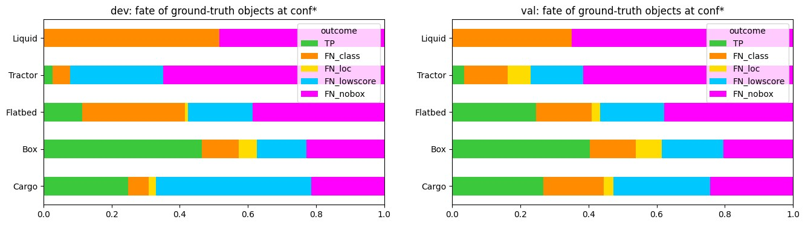
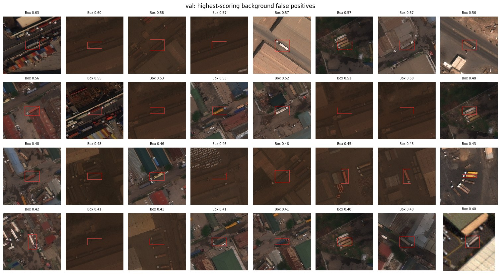
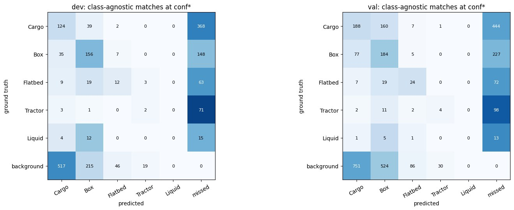
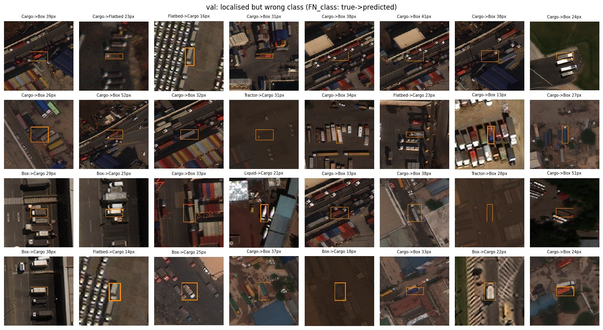

# Five-class truck detection in overhead imagery: technical report

**Task.** Detect and type five truck classes (Cargo, Box, Flatbed, Tractor, Liquid) in large overhead scenes, with a target of
0.75 mAP50 on the provided validation set. The report also has to show the diagnosis, the experimental reasoning and how
to reproduce the results.

**Outcome in one paragraph.** The target is **not reached**. Two final models are proposed. Both are COCO-initialised
YOLO11s detectors trained on native-resolution tiles and evaluated on full images with multi-label inference.
**D1 reaches val mAP50 0.106 [0.072, 0.156] and A1 0.142 [0.093, 0.217]**, against a baseline of 0.072. Fifteen training runs, an inference study, four research investigations and several analyses of the saved predictions
locate the limit in the same place. The detectors find most labelled trucks (recall 0.81–0.85 at any confidence) but cannot type them reliably: even
when every object location is given, the five-class score stays at 0.29–0.36. The Cargo/Box boundary and the rare
classes carry most of the error, and the labels themselves (ambiguous subtypes, unlabelled trucks) are a large part of
the problem. No route tried moved class-agnostic AP50 above 0.33, the practical upper bound for a class-aware score
from these detectors.

Detailed experiment records: [`docs/EXPERIMENTS.md`](docs/EXPERIMENTS.md). Run instructions: [`README.md`](README.md).
Evidence: the executed Kaggle notebooks in [`notebooks/executed/`](notebooks/executed/) (index:
[`notebooks/README.md`](notebooks/README.md)).

---

## 1. Data and evaluation protocol

### 1.1 Dataset observations that shaped the decisions

| Observation (measured) | Consequence for modelling or evaluation |
|---|---|
| 443 train / **22 val** scenes, 1369×1334 to 7204×5458 px; 7,618 / 1,552 boxes (YOLO format, axis-aligned) | Full-image inference by tiling, then stitching. The tiling and stitching are checked with the ground truth (pipeline ceiling 0.98–0.99 mAP50) |
| Objects are tiny: median √area Cargo 18.5, Tractor 18.7, Flatbed 25.9, Liquid 25.5, Box 31.5 px; 23% of objects < 16 px; largest side 161 px | Native-resolution 1024 px tiles with 200 px overlap (> largest object, so every object is whole in some tile); a 2x up-sampling arm (A1); AP reported by size bucket (xs < 16, s 16–32, m ≥ 32 px) |
| At IoU 0.5 a 20 px box tolerates only ~4 px of corner error | Localisation noise in the labels is a candidate failure cause; the IoU 0.1 → 0.5 cost was measured (≈ 15% of class-agnostic AP) |
| Strong imbalance: Cargo 49.5%, Box 31.1%, Flatbed 8.7%, Tractor 8.2%, **Liquid 2.5%** of train; val Liquid = **20 objects in 8 images**. mAP50 weights each class equally, so one val Liquid object moves mAP by ~1 point | Every result carries per-class AP50 and an image-bootstrap 95% interval. The dev split has floors for the rare classes. One experiment targets imbalance (Y6) |
| Concentration: one train image holds 27% of all Tractor boxes, ten images hold 60% | Rare-class diversity is far below the box counts suggest; rare-class results are read as low-confidence |
| **Val differs from train**: 55% of val scenes have ≥ 50 objects (train 8%); per-image object size in val ranges 9–42 px; val Liquid is larger than train Liquid (41.5 vs 25.5 px) | Val (22 images) is too small and too different to choose anything with. All decisions are made on a held-out **dev** split; val is only reported |
| Label quality: Cargo vs Box is visually ambiguous; the Tractor box covers sometimes the cab, sometimes the whole rig; hazy, low-contrast scenes (val 2470: 30% of val Box boxes nearly texture-less); trucks visibly unlabelled in dense lots ([`val_1211_unlabelled_trucks.jpg`](docs/figures/val_1211_unlabelled_trucks.jpg): image left, labels right) | The diagnosis treats "error against the labels" as a mix of model error and label effects. A blind audit of false positives, the perfect-location experiment (5.1) and the resist-learning analysis (5.2) are designed to separate them |
| Class names, ~0.3 m/px and scene sizes match **xView** | **Integrity rule:** no xView-pretrained weights (val scenes are very probably in xView's training set). COCO and DOTA initialisations are used and declared |
| No duplicate scenes between train and val (best thumbnail correlation 0.72) | No leakage correction needed (geographic overlap of partial scenes cannot be fully excluded) |

Figures: class montages [`montage_val_0_Cargo.jpg`](docs/figures/montage_val_0_Cargo.jpg), [`montage_val_1_Box.jpg`](docs/figures/montage_val_1_Box.jpg);
hazy scene [`ov_val_2470.jpg`](docs/figures/ov_val_2470.jpg); Tractor/Box convention [`ov_val_1181.jpg`](docs/figures/ov_val_1181.jpg);
coarse-scale dense scene [`ov_val_2384.jpg`](docs/figures/ov_val_2384.jpg).

### 1.2 Splits and metric

| Split | Images | Objects | Use |
|---|---|---|---|
| train_core | 377 | 6,525 | training |
| dev | 66 | 1,093 | monitoring and **every** selection or decision (stratified 15% of train with rare-class floors; fixed in `src/auric/configs/splits/dev_s0.json`) |
| val | 22 | 1,552 | reported only; never used to choose a model, a checkpoint or a setting |

* **mAP50**: COCO 101-point interpolated AP at IoU 0.5 on full images against the original labels, averaged over the five
  classes. The evaluator matches pycocotools to 1e-3 (unit-tested). Intervals are 95% image-level bootstrap intervals (1,000
  resamples). Differences between two models use a **paired** bootstrap on the same images.
* **Class-agnostic AP50**: the same with class identity removed. The gap between it and mAP50 is the cost of typing.
* The evaluated checkpoint is always `last.pt` after the fixed schedule. No early stopping and no checkpoint selection.
* Diagnostics (error outcomes, confusion) use one operating point: the confidence conf\* that maximises micro-F1 on the split.
* **Noise scale.** Training D1 again with seed 1 changes mAP50 by +0.003 on dev and −0.007 on val. Differences of that size are noise.

---

## 2. Baseline

**B0** is a COCO-initialised YOLO11s on native-resolution tiles with Ultralytics defaults (plus vertical flips). It is
evaluated on full images (`configs/baseline.yaml`; run `notebooks/executed/01_B0_baseline.ipynb`).

| | dev | val |
|---|---|---|
| mAP50 [95% CI] | 0.089 [0.053, 0.136] | **0.072** [0.047, 0.107] |
| class-agnostic AP50 | 0.265 | 0.277 |
| val per-class AP50 | | Cargo 0.120, Box 0.157, Flatbed 0.079, Tractor 0.005, Liquid 0.000 |

### 2.1 Training and inference setup (baseline and final models)

| Item | B0 (baseline) | D1 (final) | A1 (final) |
|---|---|---|---|
| Architecture / init | YOLO11s, COCO `yolo11s.pt` (Ultralytics release asset) | same | same |
| Input | tiles 1024 px, overlap 200, native resolution (imgsz 1024) | same | **tiles 512 px up-sampled 2x** to imgsz 1024 |
| Tile cache | boxes clipped at tile borders kept if ≥ 50% visible; 25% of object-free tiles kept; tiles > 50% no-data dropped | same (3,201 train / 547 dev tiles) | object-free share 0.07 (7,648 train / 1,220 dev tiles) |
| Train / val usage | train_core tiles train; dev tiles monitor (Ultralytics `val`, monitoring only) | same | same |
| Augmentation | HSV (0.015, 0.7, 0.4), translate 0.1, scale 0.5, flip up-down 0.5, flip left-right 0.5, mosaic 1.0 (off for the last 10 epochs); no mixup, copy-paste or rotation | same | same |
| Optimiser / schedule | SGD, lr0 0.01 → lrf 0.01 (linear), momentum 0.937, weight decay 5e-4, 3 warm-up epochs | same (Ultralytics scales the decay to 6.7e-4 for nbs 12) | same |
| Batch / accumulation | batch 16, nbs 64 (one update per 4 batches)¹ | **batch 16, nbs 12** (every batch is an update; ~5x the updates) | batch 8, nbs 64 |
| Epochs | 50 | 50 | 50 |
| Sampling / losses | plain shuffle; box 7.5, cls 0.5, dfl 1.5; no class weighting | same | same |
| Seed | 0 (`deterministic: true`) | 0 | 0 |
| Inference | tiles as in training; conf 0.001; NMS IoU 0.6 inside each tile; class-aware NMS 0.6 across tiles; ≤ 1,000 boxes per tile, ≤ 2,000 per image; fp16 | same | tiles 512 → 1024 |
| **Final inference setting** | | **multi-label** (every class above conf kept per box, ≤ 5,000 boxes per image) | **multi-label** |
| Hardware / time | Kaggle Tesla T4 (15 GB) | T4, 1.49 h, ≤ 11.9 GB | T4, ~3.9 h |
| Software | Ultralytics 8.4.179, torch 2.11.0 + CUDA 12.8, Python 3.13 (Kaggle image) | same | same |

¹ `baseline.yaml` says batch 8 / nbs 64; the reported run used the override `train.args.batch=16` (still ~50 updates per epoch).
All configurations are in `src/auric/configs/`. The exact Kaggle overrides of every run are listed in
[`docs/EXPERIMENTS.md`](docs/EXPERIMENTS.md).

---

## 3. Final models

**Proposal: D1 and A1, both with multi-label inference.** They are equal on dev, which is the split decisions are made on, and
each is the better model on one split:

* **D1** (5x more weight updates than B0) has the highest dev mAP50 of all runs (0.115 with multi-label; multi-label was
  measured for D1 and A1 only). It is the model the pre-declared rule (choose on dev) selects. It is also cheaper (1.5 h of training against 3.9 h).
* **A1** (2x up-sampled tiles) has the highest val mAP50 (0.142), the only substantial val Liquid AP (0.16, 3 of 20
  objects) and the highest val Box and Cargo AP.
* **Why not choose one.** D1 − A1 on dev is +0.007 [−0.012, 0.019]; on val it is −0.036 [−0.101, +0.013] (paired bootstrap).
  Neither interval excludes 0, so the data cannot separate them. Picking A1 for its higher val number would be choosing on
  val. Both are therefore reported, with D1 as the default in `reproduce.py`.

| Model (inference) | dev mAP50 [CI] | val mAP50 [CI] | val Cargo | val Box | val Flatbed | val Tractor | val Liquid | class-agnostic AP50 dev / val |
|---|---|---|---|---|---|---|---|---|
| **D1 (multi-label)** | **0.115** [0.083, 0.162] | **0.106** [0.072, 0.156] | 0.140 | 0.177 | 0.144 | 0.045 | 0.022 | 0.288 / 0.280 |
| **A1 (multi-label)** | **0.108** [0.076, 0.161] | **0.142** [0.093, 0.217] | 0.164 | 0.270 | 0.073 | 0.040 | 0.161 | 0.245 / 0.294 |
| D1 (single-label) | 0.101 [0.068, 0.147] | 0.088 [0.053, 0.137] | 0.110 | 0.155 | 0.131 | 0.043 | 0.000 | 0.299 / 0.297 |
| A1 (single-label) | 0.100 [0.067, 0.152] | 0.131 [0.082, 0.207] | 0.148 | 0.255 | 0.060 | 0.036 | 0.158 | 0.252 / 0.303 |

Dev per-class AP50 (multi-label), D1 / A1: Cargo 0.114 / 0.120, Box 0.351 / 0.298, Flatbed 0.073 / 0.052, Tractor 0.018 / 0.050, Liquid 0.018 / 0.021.
Source: `notebooks/executed/05_MX_multilabel_inference_D1_A1.ipynb`. **Reproduced** with `reproduce.py` for D1: val 0.1057,
dev 0.1147 (multi-label) and val 0.0877 (single-label), with identical per-class values.

**What is still weak.** Every class except dev Box is below 0.20 AP50. Tractor stays below 0.06, and Liquid is close to zero
for D1. The intervals are wide, because val has 22 images and 20 Liquid objects.

---

## 4. Diagnosis: what the detector gets wrong

All numbers in 4.1–4.3 are D1 single-label at its operating point (val conf\* = 0.089). Source: `notebooks/executed/02_D1_more_weight_updates_FINAL.ipynb`,
Stage 6, where the figures below come from. A1 shows the same pattern (`docs/figures/A1_*`).

### 4.1 Failure taxonomy

Every ground-truth object and every kept detection receives exactly one outcome (TIDE-style definitions; background = IoU < 0.1 with every object).

| Ground-truth outcome (val, 1,552 objects) | n | share | Detection outcome (val, 2,089 kept) | n | share |
|---|---|---|---|---|---|
| TP | 447 | 28.8% | TP | 447 | 21.4% |
| **FN_nobox**: no same-class box at any score | 427 | 27.5% | **background** (IoU < 0.1 with every object) | 1,010 | **48.3%** |
| **FN_lowscore**: found only below conf\* | 357 | 23.0% | **wrong class** (IoU ≥ 0.5 with another class) | 393 | 18.8% |
| **FN_class**: localised, typed as another class | 251 | 16.2% | mislocalised (same class, 0.1 ≤ IoU < 0.5) | 102 | 4.9% |
| FN_loc: same class, 0.1 ≤ IoU < 0.5 | 70 | 4.5% | wrong class and mislocalised | 118 | 5.6% |
| | | | duplicate | 19 | 0.9% |

The dominant modes are **background detections**, **objects found only at low confidence** and **typing errors**.
Mislocalisation is small. Dev shows the same structure (TP 28%, background 55% of kept detections).

* **Found, but not separated.** Counting a box at IoU ≥ 0.5 of any class at *any* confidence, 81–85% of objects are found
  (90–92% at IoU 0.1). The score is low because the correct boxes rank among many confident wrong ones, not because objects
  are missed outright. Only 15–18% of objects never receive a box.
* **Systematic, not noise.** D1's confident background detections are found again by A1 at the same places (60% dev / 77% val, as
  often as its true positives). 11% of objects are missed by both models at any confidence, against 3% expected if their
  errors were independent. Taking the union of the two models adds only +0.005 mAP50.
* **Localisation at IoU 0.5 is a modest cost.** Class-agnostic AP falls from 0.357 to 0.303 between IoU 0.1 and 0.5 (−15%).
  Crowding is no limit: 7–10% of boxes overlap a neighbour at IoU > 0.3.

### 4.2 False negatives and false positives as populations

| Population | Size of the effect | Evidence |
|---|---|---|
| **Small objects (xs, < 16 px)** | val AP50 xs 0.044 / s 0.073 / m 0.106; recall at conf\* xs 0.14, m 0.41. Across three models, 81% of dev xs objects are found by none (m: 17%) | Stage 6 of the D1 run; 5.2 (section 6.2) |
| **Rare classes** | Tractor recall at conf\* 0.03, maximum recall at any confidence 0.28; Liquid: D1 emits **no Liquid box at any confidence** (FN_nobox or FN_class for all 20 val Liquid objects) | per-class tables; confusion matrix |
| **Hard scenes** | Recall varies by scene from 0.02 to 0.59; the lowest are val 1447 (0.02, a port scene), 2543 (0.04), 2384 (0.04) and 2460 (0.13); 2384 and 2460 are at a much coarser scale than training. Removing 2384 and 2460 moves val mAP50 by only +0.004, so they are not the cause of the low score | per-image table; analysis P4 |
| **Background FPs are often unlabelled trucks** | Blind audit of 200 crops (one rater, judged before the group key was opened): **42–45% of confident unmatched detections are clearly truck-like vehicles without a label**, 67–72% are some vehicle; controls: random boxes 0–3%, labelled detections 80%. Counting the truck-like ones as correct would lift precision at conf\* from ≈ 0.24 to ≈ 0.45–0.48 | `docs/EXPERIMENTS.md`, analysis AU. Measured on dev; on val the crops were too dark to judge, so the val rate is unknown |
| **Faint clutter** | The other ~30% of unmatched detections are faint or not vehicles: genuine model errors | same audit |

### 4.3 Class confusion

At conf\*, among objects the detector localises (class-agnostic match, val):

| ground truth → predicted | Cargo | Box | Flatbed | Tractor | Liquid | missed |
|---|---|---|---|---|---|---|
| Cargo (800) | 188 | **160** | 7 | 1 | 0 | 444 |
| Box (493) | **77** | 184 | 5 | 0 | 0 | 227 |
| Flatbed (122) | 7 | 19 | 24 | 0 | 0 | 72 |
| Tractor (117) | 2 | 11 | 2 | 4 | 0 | 98 |
| Liquid (20) | 1 | 5 | 1 | 0 | 0 | 13 |
| background | 751 | 524 | 86 | 30 | 0 | – |

**Systematic patterns.**
1. Cargo and Box are confused symmetrically and heavily: 160 localised val Cargo trucks are called Box, against 188 called
   Cargo. The confusion depends on **size**: large Cargo trucks and small Box trucks fail (section 6.2). The geometric
   separability of the two labels is itself limited (on size alone, AUC 0.83; on aspect ratio, 0.63).
2. The rare types are absorbed by the common ones (Flatbed → Box, Liquid → Box/Cargo, Tractor → Box). The same absorption
   appears in a separate crop classifier given the true boxes (5.1), so it is not specific to the detector.
3. Liquid is never predicted by D1. A1, with 2x up-sampling, predicts 3 of the 20 val Liquid objects correctly; that is its
   whole val gain on Liquid.

**Qualitative examples** (all in `docs/figures/`):
* A scene where the model works best ([`D1_multilabel_val_best_scene_2470.jpg`](docs/figures/D1_multilabel_val_best_scene_2470.jpg), recall 0.59).
* A typical scene ([`D1_multilabel_val_median_scene_31.jpg`](docs/figures/D1_multilabel_val_median_scene_31.jpg), recall 0.37).
* The worst scene ([`D1_val_worst_image_overlay.jpg`](docs/figures/D1_val_worst_image_overlay.jpg)).
* Galleries of objects never boxed, found only at low score, typed wrongly, confident background boxes and confident
  wrong-class boxes (`D1_val_fn_*.jpg`, `D1_val_fp_*.jpg`).
* The same set for A1 (`A1_*`).

Colours in the scene overlays: green TP, orange wrong class, yellow mislocalised, cyan low score, magenta no box, red false positive.

### 4.4 Competing explanations and the tests that discriminate them

| Explanation | What would support it | Test run | Result |
|---|---|---|---|
| Under-training / optimisation | more updates lift the score | D1: 5x updates vs B0 | **rejected**: 0.101 vs 0.089 dev, inside the CIs; dev loss flat from epoch 15–20 |
| Resolution (small objects) | 2x up-sampling lifts xs AP | A1 | **not supported on dev**: dev mAP50 equal, xs AP 0.026 → 0.015 (dev), 0.044 → 0.073 (val) |
| Architecture capacity | a newer detector does better | Y1 (YOLO26s) | **rejected**: 0.106 vs 0.101 dev |
| Representation (COCO is not aerial) | an aerial backbone helps | DT1 (DOTA init) | **rejected**: class-agnostic 0.275 vs 0.326 for the COCO control |
| Fused objectness and class score | a single-class detector finds clearly more | T1 | **inconclusive**: class-agnostic +0.027 (0.326), below the pre-declared +0.10 |
| Typing is the bottleneck | a stronger, decoupled classifier lifts mAP; perfect boxes leave little error | TS1, 5.1 | **typing is a bottleneck**, and a stronger classifier does not fix it (section 5) |
| Class imbalance | class weights and sampling lift rare classes | Y6 | **not supported**: rare-class recall fell |
| Labels: subtype ambiguity, missing labels | errors concentrate where labels are ambiguous; FPs are unlabelled trucks | AU audit, 5.1, 5.2 | **supported in part**: 42–45% of confident FPs are unlabelled trucks (dev); Cargo/Box and rare-type errors are shared by every model and the crop classifier. The share of error due to labels is **not measured** (no blinded relabelling) |
| Data scarcity | the learning curve keeps rising | 5.3 learning curve | **weak**: +0.016 mAP50 per doubling of labels |

---

## 5. Experiment chain

Each experiment asked one question that followed from the previous result. Full records in the assignment's format
(observation, hypothesis, change, result, conclusion, next) are in [`docs/EXPERIMENTS.md`](docs/EXPERIMENTS.md).

| ID | Question | Change vs control | dev mAP50 | val mAP50 | class-agn. AP50 dev / val | Verdict |
|---|---|---|---|---|---|---|
| B0 | reference | — | 0.089 | 0.072 | 0.265 / 0.277 | baseline |
| D1 | is B0 under-trained? | nbs 64 → 12 (5x updates) | 0.101 | 0.088 | 0.299 / 0.297 | no; **final model** |
| D1 s1 | how large is seed noise? | seed 1 | 0.104 | 0.081 | 0.295 / 0.283 | ±0.003 dev / 0.007 val |
| A1 | is resolution the limit? | 512 px tiles up-sampled 2x | 0.100 | 0.131 | 0.252 / 0.303 | no on dev; **final model** |
| MX | does emitting every plausible class help? | multi-label inference, same weights | D1 0.115, A1 0.108 | D1 0.106, A1 0.142 | −0.01 | **yes**: +0.014 [0.009, 0.024] (D1, dev) |
| T1 | does the fused class score cost detection? | single-class training | n/a | n/a | **0.326 / 0.324** | inconclusive (+0.027) |
| DT1 | does an aerial initialisation help detection? | T1 with a DOTA backbone | n/a | n/a | 0.275 / 0.277 | no |
| **TS1** | **is decoupling + a stronger classifier better?** | **T1 boxes + ConvNeXt-tiny crop classifier** | **0.080** | **0.098** | ceiling 0.326 / 0.324 | **no** |
| **PL (5.1)** | **how much remains with perfect locations?** | **TS1 classifier on ground-truth boxes** | **0.29** | **0.36** | — | **most of the problem remains** |
| Y1 | is the architecture the limit? | YOLO26s | 0.106 | 0.088 | 0.293 / 0.283 | no |
| Y2 | whole scenes instead of tiles? | scenes at imgsz 3008 | 0.054 | 0.035 | 0.195 / 0.187 | clearly worse |
| Y6 | does rebalancing help rare classes? | class weights + class-aware sampler (+ cls 1.5, batch 12) | 0.075 | 0.081 | 0.215 / 0.258 | no (confounded) |
| SR / SC | 5.3 / 5.4 | training subsets | 0.031–0.084 | 0.014–0.065 | | section 6 |

Per-class val AP50 of every model: [Appendix A](#appendix-a-per-class-val-ap50-of-every-reported-model).

### 5.1 The decoupling line (T1 → DT1 → TS1 → 5.1): the experiment that located the limit

The analyses of the first models showed that objects are found (recall 0.81–0.85) but scored and typed badly
(class-agnostic AP ≈ 0.30, class-aware ≈ 0.10). Four steps separated detection from typing:

1. **T1: one class.** Training one "truck" class asks whether the five-way objective costs detection. Class-agnostic AP50
   rose from 0.299 to only **0.326** (dev; val 0.324). By the rule declared before the run (≥ 0.40 supports, ≤ 0.32 rejects)
   this is inconclusive at a small effect. Detection alone is bounded at about a third.
2. **DT1: aerial initialisation.** A DOTA-pretrained backbone instead of COCO gave 0.275. The pretrained representation is
   not the detection limit.
3. **TS1: two stages.** T1's boxes (class-agnostic merge) are typed by a separately trained ConvNeXt-tiny crop classifier
   (3x context, class-balanced loss). Pre-declared rule: it beats the fused head if dev mAP50 ≥ D1 + the CI width (≈ 0.13).
   Result: **0.080 dev / 0.098 val**, below D1 (0.101). The typing step costs 0.22–0.25 AP between the 0.33 detection
   ceiling and the final score.
4. **5.1: perfect locations.** The same classifier on the ground-truth boxes gives only **0.29 (dev) / 0.36 (val)** mAP50
   with two labels per box. The boxes are not what hurts typing: 87% of objects get the same type from the detector's box
   as from the true box, with equal accuracy (0.58 vs 0.57 dev).

**What this established.** Neither stage alone is near the target. Perfect detection with this typing gives about 0.3.
Perfect typing on these detections gives the 0.33 detection ceiling. With both imperfect the score is about 0.1. The
classifier fits its training labels (in-sample accuracy 0.986) but reaches only 0.57–0.58 on held-out objects, where always
answering Cargo gives 0.49–0.52. A classifier that fits its labels but does not generalise points to label ambiguity and
few examples rather than to capacity. That is why the remaining work went to the label-centred investigations (5.2–5.4)
and not to more architectures.

---

## 6. Research investigations

### 6.1 (5.1) If object locations were perfect

**Design.** Remove localisation by giving the classifier the ground-truth boxes: every labelled object becomes a detection,
typed by the TS1 crop classifier (trained on train_core crops only; dev and val images are unseen), with score = p(class).
It is scored by the same evaluator, emitting the top 1, 2 or 5 classes per box. Pre-declared expectations:
A ≥ 0.38; A ≤ 0.45 means the five-way problem stays far from 0.75. Source:
`notebooks/executed/08_TS1_two_stage_and_5.1_perfect_locations.ipynb`.

| | dev | val |
|---|---|---|
| mAP50 with perfect boxes, 1 / 2 / 5 labels per box | 0.233 / **0.292** / 0.361 | 0.291 / **0.358** / 0.421 |
| 95% CI (2 labels) | [0.243, 0.349] | [0.279, 0.444] |
| held-out typing accuracy (majority-class baseline) | 0.569 (0.488) | 0.581 (0.515) |
| balanced accuracy (chance 0.20) / top-2 accuracy | 0.348 / 0.726 | 0.408 / 0.764 |
| perfect-box AP50 per class (2 labels): Cargo / Box / Flatbed / Tractor / Liquid | 0.62 / 0.43 / 0.06 / 0.30 / 0.06 | 0.61 / 0.48 / 0.25 / 0.30 / 0.15 |
| detection ceiling → perfect boxes → real two-stage | 0.326 → 0.292 → 0.080 | 0.324 → 0.358 → 0.098 |

**How much remains:** with localisation removed, **64–71% of the AP is still missing** (1 − 0.29…0.36). Typing alone
keeps the problem far below 0.75. The errors form one block: rare types are absorbed by Cargo and Box (Flatbed → Cargo/Box
0.83 dev; Liquid → Cargo/Box 0.90 dev), and Box ↔ Cargo is the largest common confusion (Box → Cargo 0.35). A ≤ 0.45 was
met. A ≥ 0.38 was **not** met at two labels per box.

**What this experiment cannot establish.**
1. Ambiguity versus inability: a held-out error mixes a weak classifier with inconsistent labels (xView labellers typed a
   subtype only when confident). The Bayes error is unknown; a blinded relabelling is the missing control.
2. One classifier family, one context size, one seed: a better classifier could move the number.
3. "Perfect" covers labelled objects only. Unlabelled trucks, the main source of false positives, do not exist in this
   setting, so the real problem is harder.
4. The boxes are annotator boxes, not exact.
5. Rare classes are small: 20 val Liquid objects in 8 images.
6. Objects in one scene share conditions, so near-duplicates across splits cannot be excluded.

### 6.2 (5.2) Which examples resist learning?

**Principle.** An object *resists learning* if **none of three independently trained full-data detectors solves it**: D1
seed 0, D1 seed 1 and A1. *Solved* means found at IoU ≥ 0.5 with the right class at the model's own operating point, chosen
on dev and applied unchanged to val. Using several models removes one model's noise: the two D1 seeds disagree on only 9%
of objects. Protocol and decision rule were written before the run (`notebooks/03_resist_learning.ipynb`; executed:
`notebooks/executed/12_RL_5.2_resist_learning.ipynb`).

**Departure from the assignment's wording, stated plainly.** The runs saved no predictions on the training images, so the
objects analysed are the held-out ones: dev (1,093) and val (1,552). The "training behaviour" used is the repeated failure
across trained models, not per-example training loss. Train-set recovery and per-instance loss dynamics were **not** done.

**How many.** No full-data model solves **62% of dev / 67% of val** objects (`R_miss`). None of them even finds 48% / 49%
(`R_notfound`).

**One population or several? Several, overlapping:**

| Population | Evidence (dev / val) | Mechanism: competing explanations and what the data favours |
|---|---|---|
| **Smallest objects** | not found by any model: xs 0.81 / 0.75 against m 0.17 / 0.29; for xs objects 0.63–1.00 by class (val Flatbed xs: 0.40, 10 objects) | Resolution (few pixels on the stride-8 map) vs. annotation jitter at IoU 0.5. A1's 2x up-sampling did not consistently raise xs AP, so resolution alone does not explain it; the unlabelled-neighbour effect is untested |
| **Rare types** | unsolved: Liquid 0.97 / 0.85, Tractor 0.92 / 0.95, Flatbed 0.83 / 0.76 (base 0.62 / 0.67). Tractor is the class most often not found at all (0.84 / 0.80) | Few and concentrated examples (Tractor: 27% in one image) vs. label convention (Tractor boxes cover the cab or the whole rig, which makes the box extent inconsistent). Tractor is typed reasonably with perfect boxes (AP 0.30) yet not found by detectors, which favours the box-convention/detection explanation for Tractor; for Liquid and Flatbed the detectors type found objects as Box (Liquid → Box 0.33 dev) |
| **Cargo ↔ Box, by size** | Box unsolved 0.21 / 0.33 when large (m) but 1.00 / 0.86 when xs; Cargo fails most when large (m 0.79 / 0.81, against s 0.42 / 0.65) | The models use size as the class cue (large → Box, small → Cargo), so large Cargo and small Box fail. Either a learned shortcut or a genuinely size-driven annotation boundary; only a blinded relabelling separates them |
| **Not a population** | crowding and scene brightness: lift 0.95–1.04 on dev and val; scene density and border contact move on dev (0.48–1.25; border: 33 objects) but not on val (0.96–1.11) | No consistent effect of scene conditions |

**Prediction, then test.** A logistic model on attributes only (class, size, crowding, border, scene density, brightness,
sharpness) was **fitted on dev** to predict `R_miss`, then **tested on val**, whose outcomes it never saw. Declared rule:
val AUC lower bound > 0.5 and top-fifth hit rate ≥ 1.3 × base rate.
Result: **AUC 0.646 [0.531, 0.752], top-fifth lift 1.32 [1.14, 1.55]: supported, narrowly.** The model is barely better than
size alone (AUC 0.638 [0.485, 0.754]): the transferable signal is mostly "small and rare", not a richer description.

**Limits.** Held-out objects, not training objects. Three detectors that share data and labels, so shared blind spots count
as resistance. 66 + 22 images. No blinded relabelling.

### 6.3 (5.3) Would another 500 labels matter?

**Evidence: the detector's own learning curve.** The D1 recipe was trained on random subsets of 12.5%, 25% and 50% of the
train_core instances (one subset draw each, `notebooks/executed/13_S_5.3_5.4_subset_analysis.ipynb`). A log-linear fit
through the three subsets and the two full-data seeds gives:

| | slope per doubling of labels (± se) | +500 labels (≈ 0.11 doublings) |
|---|---|---|
| mAP50, dev | 0.016 ± 0.001 | **+0.002** (1.7% of the full score) |
| mAP50, val | 0.020 ± 0.002 | +0.002 (2.5%) |
| class-agnostic AP50, dev | 0.033 ± 0.003 | +0.004 |

**Conclusion: no, 500 labels would not materially improve the system.** The expected gain (+0.002) is about a fortieth of the
width of the val interval of D1 (0.08) and negligible against the gap to 0.75.

**Which classes benefit most and least (dev slopes per doubling).** Box **0.042**, Cargo 0.016, Flatbed 0.016, Tractor 0.004, Liquid 0.000.
If all 500 went to one class, the extrapolated gain would be Flatbed +0.015, Box +0.013, Tractor +0.004, Cargo +0.003 and Liquid 0.
* **Most:** Box (steepest curve), and Flatbed if labels are targeted (few instances, so 500 is a large relative increase).
* **Least:** Liquid (AP 0 at every budget from 12.5% to 100%, an 8x range) and Tractor (flat). Tractor already reaches
  AP 0.30 when its location is given (5.1), so its limit is finding the object, not the sample count.

**Sample count versus other limits.** The curve is shallow but not flat for Cargo and Box: count helps a little. For
Tractor and Liquid an 8x increase in data changed nothing, which points to other limits: box convention and detection for
Tractor, rarity and ambiguity for Liquid (section 6.2). The perfect-box classifier shows that typing stays at 0.29–0.36
even with all labels.

**Assumptions and uncertainty.**
* New labels come from the same source and labelling process.
* The log-linear trend holds 0.11 doublings beyond the data.
* The quoted se ignores subset-draw variance: one draw per budget, and the two seeds differ by 0.003–0.007.
* The per-class extrapolation assumes each class responds to its own count only.
* The val effect is unmeasurable at this size (val interval ±0.04).

### 6.4 (5.4) A small effective training subset

**Declared before training** (`notebooks/04_subset_efficiency.ipynb`, protocol fixed before any subset run):
* Budgets of 50%, 25% and 12.5% of the train_core instances, all trained with the D1 recipe.
* **Coverage selection**: greedy, to cover every class × size cell up to a quota of at least 20 instances, with sparse
  images preferred per instance cost.
* Compared against a **random** image subset of the same instance budget.
* Success means at least 90% of the full-data mAP50 (mean of the two D1 seeds) on val **and** on dev. The thresholds are
  0.076 val and 0.092 dev.

| Subset | images | instances | Cargo / Box / Flatbed / Tractor / Liquid | median inst./image | val mAP50 (% of full) | dev mAP50 (% of full) |
|---|---|---|---|---|---|---|
| full (D1 s0, s1) | 377 | 6,525 | 3,240 / 2,020 / 556 / 548 / 161 | | 0.081–0.088 | 0.101–0.104 |
| random 50% | 198 | 3,240 | 1,523 / 1,214 / 247 / 172 / 84 | 8 | 0.065 (77%) | 0.084 (82%) |
| random 25% | 102 | 1,630 | 905 / 463 / 148 / 74 / 40 | 8 | 0.037 (44%) | 0.064 (63%) |
| random 12.5% | 54 | 806 | 460 / 209 / 85 / 34 / 18 | 8 | 0.028 (33%) | 0.055 (54%) |
| **coverage 25%** | 180 | 1,629 | 701 / 534 / 169 / **157** / **68** | 3 | 0.031 (36%) | 0.059 (57%) |
| **coverage 12.5%** | 136 | 801 | 291 / 269 / 97 / **96** / **48** | 3 | 0.014 (17%) | 0.031 (30%) |

* **Smallest successful subset actually tested: none below the full set.** Random 50% is the closest (77% / 82%). On dev it
  falls short of the full model by 0.017 [0.009, 0.043] (paired). On val the shortfall, 0.023 [−0.003, 0.062], is not
  resolved. No minimum is claimed.
* **Coverage vs random, same budget (paired):** 25%: −0.006 [−0.019, 0.008] dev, −0.007 [−0.021, 0.009] val, so no
  difference. 12.5%: **−0.025 [−0.041, −0.013] dev**, −0.014 [−0.025, −0.002] val, so coverage is worse. With one
  random draw per budget, "coverage beats random" could only have been claimed against a range of random draws. It is
  not supported in any case.
* **What survives selection, and what makes examples useful.** Coverage selection kept the rare classes: 2x the Tractor and
  1.7x the Liquid instances of random at 25%. To do that it took 1.8–2.5x more images with a median of 3 objects each,
  against 8 for random. The extra rare-class instances bought almost **nothing**: Tractor AP rose from 0.000 to 0.006 (dev) and Liquid stayed at
  exactly 0. What was lost was the dense Cargo/Box scenes; at 12.5% Box AP fell by 0.081 [0.020, 0.151] and Cargo AP by
  0.027 [0.004, 0.064] (dev, paired). The useful examples are the
  dense scenes of the common classes. They resemble val (median 76 objects per image) and carry the Cargo/Box contrast
  that most of the score depends on.
* **Redundancy.** Halving the data costs about 0.016 dev mAP50 (17–23% of the score at 50%). The data is not redundant at
  this model quality, and rare-class coverage is not the bottleneck.

---

## 7. Final analysis

### 7.1 Dominant limitations of the final detectors
1. **Typing under ambiguous labels.** Even with perfect locations the five-class score is 0.29–0.36. On the detectors'
   own boxes, class identity costs a factor of about 2.5–3 (class-agnostic 0.29 → mAP50 0.115). Cargo ↔ Box (size-driven) and
   the absorption of the rare types are shared by every model and by a separate classifier.
2. **Separation, not finding.** 81–85% of objects get a box at some confidence, but true boxes rank among confident
   background boxes: 48% of kept val detections are background. On dev, 42–45% of the confident ones are unlabelled trucks.
3. **Small objects and the rare classes**, which most models never solve (section 6.2): Liquid is almost never detected,
   and Tractor is rarely found.
4. **A small, shifted validation set.** 22 dense images, 20 Liquid objects. Val intervals are ±0.04–0.06, wider than most
   effects measured.

### 7.2 What is supported, what is unresolved, what was rejected

| Strongly supported | Plausible but unresolved | Weakened or rejected |
|---|---|---|
| The limit is not optimisation (D1), architecture (Y1), aerial initialisation (DT1) or the tile formulation (Y2 is worse) | **How much of the typing error is label ambiguity vs. too few examples**: both act; not separated without a blinded relabelling | "B0 is under-trained": rejected (D1) |
| Multi-label inference helps: +0.014 [0.009, 0.024] (D1) and +0.008 [0.005, 0.012] (A1) on dev | Whether val has as many unlabelled trucks as dev | "Small objects need up-sampling": weakened (A1 equal on dev, xs AP not consistently higher) |
| Typing remains the main limit even with perfect boxes (0.29–0.36), and decoupling with a stronger classifier does not help (TS1 0.080) | Whether D1 or A1 is better (dev +0.007 vs val −0.036, both inside noise) | "The fused objective costs detection": weakened (T1 +0.027, inconclusive) |
| 500 more labels would add about +0.002; rare classes do not respond to more data at these budgets | The individual effect of each imbalance lever (Y6 changed four things at once) | "Decoupling + a stronger classifier is better": rejected (TS1) |
| Coverage selection is not better than random; dense common-class scenes are the useful data | Whether the Cargo/Box size cue is a model shortcut or the annotators' boundary | "Class weights and sampling help the rare classes": not supported (Y6) |
| Failures are systematic, not variance (shared blind spots; two seeds disagree on 9% of objects) | Whether the T1 gain (+0.027) is real (no seed repeat) | "Aerial pre-training helps": rejected for DOTA |

### 7.3 What changed most between the initial and the final system
B0 (val 0.072, dev 0.089) → D1 multi-label (val 0.106, dev 0.115) and A1 multi-label (val 0.142, dev 0.108).
* **The one change with a resolved effect is at inference: emitting every plausible class per box** (D1: +0.014 dev,
  +0.018 [0.010, 0.031] val, paired). Its gain is largest on Box, Flatbed and Liquid, the classes with the most
  ambiguity, while class-agnostic AP drops slightly (−0.01). This is the signature of hedging an ambiguous type, not of
  better detection, and it agrees with the diagnosis that typing, not finding, is the limit.
* More weight updates (B0 → D1: +0.012 dev, +0.016 val) and 2x up-sampling (A1: +0.059 val, +0.011 dev over B0) are within
  the noise. A1's val gain comes from 3 of the 20 Liquid objects and from Box, and does not appear on dev.

### 7.4 The single highest-priority next step: a blinded relabelling audit (one working day)
Two raters re-type a stratified sample of about 400 dev/val objects, without seeing the labels or the predictions. The
sample covers the Cargo/Box boundary across sizes, every rare-class object in val, and xs objects. The raters also judge
about 200 confident unmatched detections on **val**. The output is:
* the agreement between raters and with the given labels, per class: an estimate of the achievable typing accuracy;
* the missing-label rate on val: the precision cap.

**Why this beats the alternatives.** Every run so far trained and scored on the same labels, so no further model run can
tell "the model cannot" from "the labels do not allow". It is the one question that decides how the remaining effort
should be spent:
* If raters agree with each other far more than the model agrees with the labels, the classifier side is worth more work.
  The candidates are context models, more Box/Flatbed data (the classes 5.3 ranks first) and Tractor box rules.
* If raters disagree as much as the model does, 0.75 is not reachable with this label space. The work then shifts to
  relabelling or merging the ambiguous subtypes.

Compared with the other options, the audit is cheap and decisive:
* A seed repeat, Y3–Y5 or a larger detector each answer a question already bounded by the 5.1 result.
* 500 more labels are predicted to add +0.002.

---

## 8. Reproducibility

* **Validation predictions and metrics:** `python reproduce.py --model D1` and `python reproduce.py --model A1` (commands,
  inputs and outputs in [`README.md`](README.md)). They read `config.yaml` and the checkpoints in `weights/`, run tiled
  inference on `Dataset/CV_Assignment_AAL/val`, and write the predictions and every table behind sections 3–4. Verified
  locally for D1: identical mAP50 and per-class AP50 to the Kaggle evaluation.
* **Training:** `notebooks/01_train_and_evaluate.ipynb` with `EXPERIMENT = "D1"` or `"A1"` (the configs in
  `src/auric/configs/`). Each run writes its resolved config, environment and checkpoint hashes to `work/runs/<run>/`.
* **Research notebooks:** 5.1 `02_two_stage_and_perfect_locations`, 5.2 `03_resist_learning`, 5.3/5.4 `04_subset_efficiency`.
* **Integrity rules held throughout:**
  * val never selected anything;
  * `last.pt` was always the evaluated checkpoint;
  * no xView-pretrained weights were used;
  * decision rules were written before each run they judge.
* **External resources:**
  * Ultralytics YOLO11s / YOLO26s and their COCO checkpoints;
  * the Ultralytics YOLO11s-OBB DOTAv1 checkpoint (DT1 only);
  * the torchvision ImageNet ConvNeXt-tiny (TS1 only);
  * pycocotools (evaluator tests);
  * the xView paper, for the labelling policy.

---

## Appendix A. Per-class val AP50 of every reported model

mAP50 = mean of the five class AP50 values. Intervals are image-bootstrap 95% intervals. T1 and DT1 are single-class detectors: only their class-agnostic AP50 is meaningful (0.326 / 0.324 and 0.275 / 0.277, dev / val).

| Model | val mAP50 [CI] | Cargo | Box | Flatbed | Tractor | Liquid | dev mAP50 [CI] |
|---|---|---|---|---|---|---|---|
| B0 (baseline) | 0.072 [0.047, 0.107] | 0.120 | 0.157 | 0.079 | 0.005 | 0.000 | 0.089 [0.053, 0.136] |
| D1 | 0.088 [0.053, 0.137] | 0.110 | 0.155 | 0.131 | 0.043 | 0.000 | 0.101 [0.068, 0.147] |
| **D1 multi-label (final)** | **0.106** [0.072, 0.156] | 0.140 | 0.177 | 0.144 | 0.045 | 0.022 | **0.115** [0.083, 0.162] |
| D1 seed 1 | 0.081 [0.053, 0.121] | 0.120 | 0.170 | 0.101 | 0.012 | 0.000 | 0.104 [0.067, 0.146] |
| A1 | 0.131 [0.082, 0.207] | 0.148 | 0.255 | 0.060 | 0.036 | 0.158 | 0.100 [0.067, 0.152] |
| **A1 multi-label (final)** | **0.142** [0.093, 0.217] | 0.164 | 0.270 | 0.073 | 0.040 | 0.161 | **0.108** [0.076, 0.161] |
| TS1 two-stage | 0.098 [0.064, 0.153] | 0.136 | 0.190 | 0.109 | 0.007 | 0.050 | 0.080 [0.053, 0.122] |
| Y1 (YOLO26s) | 0.088 [0.057, 0.131] | 0.113 | 0.199 | 0.114 | 0.013 | 0.000 | 0.106 [0.069, 0.153] |
| Y2 (whole scenes) | 0.035 [0.026, 0.050] | 0.073 | 0.103 | 0.000 | 0.000 | 0.000 | 0.054 [0.036, 0.080] |
| Y6 (imbalance levers) | 0.081 [0.045, 0.115] | 0.143 | 0.235 | 0.028 | 0.001 | 0.000 | 0.075 [0.044, 0.113] |
| random 50% | 0.065 [0.043, 0.093] | 0.113 | 0.160 | 0.050 | 0.003 | 0.000 | 0.084 [0.049, 0.127] |
| random 25% | 0.037 [0.027, 0.059] | 0.083 | 0.074 | 0.029 | 0.000 | 0.000 | 0.064 [0.044, 0.096] |
| random 12.5% | 0.028 [0.018, 0.045] | 0.071 | 0.056 | 0.011 | 0.001 | 0.000 | 0.055 [0.039, 0.080] |
| coverage 25% | 0.031 [0.021, 0.053] | 0.063 | 0.044 | 0.037 | 0.009 | 0.000 | 0.059 [0.042, 0.087] |
| coverage 12.5% | 0.014 [0.008, 0.028] | 0.034 | 0.014 | 0.020 | 0.002 | 0.000 | 0.031 [0.022, 0.042] |
| PL: perfect boxes, 2 labels (5.1) | 0.358 [0.279, 0.444] | 0.611 | 0.482 | 0.251 | 0.298 | 0.149 | 0.292 [0.243, 0.349] |
